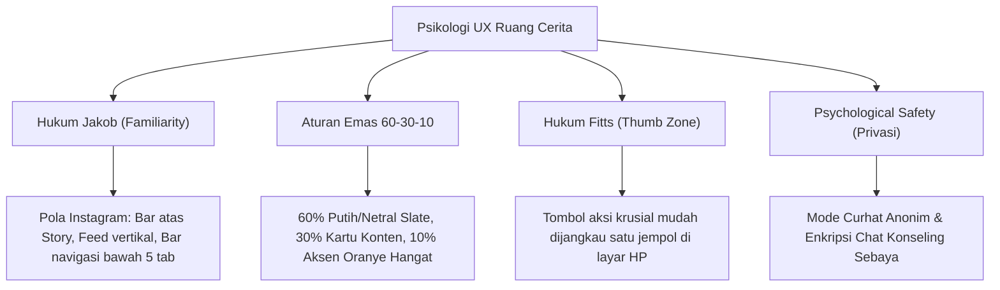
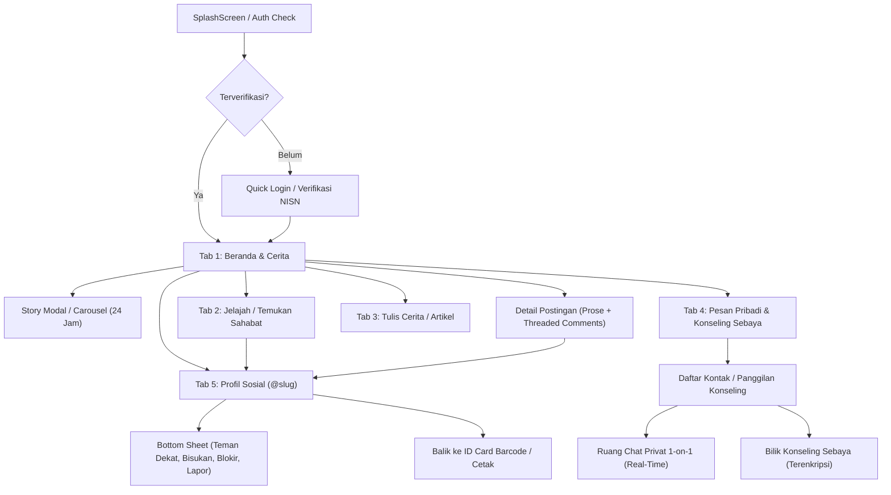
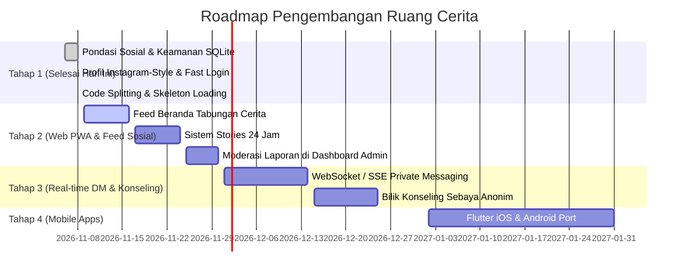

# 📱 Master Blueprint & Arsitektur Sistem: "Ruang Cerita PIK-R"
> **Pusat Informasi & Konseling Remaja (PIK-R) MAN 1 Muara Enim**  
> *Arsitektur Platform Sosial Interaktif & Aplikasi Mobile (Web + Flutter)*

---

## 🎯 1. Visi & Identitas Aplikasi

### A. Rekomendasi Nama & Subdomain
1. **Pilihan Utama: `Ruang Cerita PIK-R` (`cerita.pikr-manseku.my.id` atau `ruang-cerita.pikr-manseku.my.id`)**
   * *Alasan:* Sesuai dengan esensi utama PIK-R yaitu **Konseling Sebaya (Peer Counseling)**. Remaja tidak ingin merasa "digurui", mereka ingin tempat yang aman untuk bercerita, saling mendukung, dan berekspresi tanpa takut dihakimi (*judgement-free zone*).
2. **Alternatif: `Sobatter PIK-R` (Sobat Remaja)**
   * Berfokus pada komunitas pertemanan sebaya lintas angkatan dan alumni.

### B. Posisi Produk
* **Bukan sekadar feed media sosial biasa**, melainkan kombinasi:
  $$\text{Ekosistem Sosial Modern (Gaya Instagram)} + \text{Ruang Aman Konseling Remaja (Privat \& Terpercaya)}$$
* Terhubung langsung dengan akun keanggotaan terverifikasi PIK-R MANSEKU, ID Card digital, dan dashboard pengurus/konselor sebaya.

---

## 🧠 2. Fondasi Psikologi Desain & Kaidah UX

Rancangan antarmuka disusun berdasarkan prinsip-prinsip psikologi kognitif agar aplikasi terasa akrab, menenangkan, dan adiktif secara positif (*habit-forming for youth*):

1. **Hukum Jakob (*Jakob's Law of Internet User Experience*)**:
   * *Prinsip:* Pengguna menghabiskan sebagian besar waktu mereka di aplikasi populer lain (Instagram, TikTok, WhatsApp).
   * *Penerapan:* Jangan mendesain navigasi asing yang membingungkan. Bar cerita (*Stories*) berbentuk lingkaran di atas, feed kartu rasio 4:5 atau 1:1, *bottom navigation bar* 5 tab (Home, Jelajah, Tulis/Cerita, Pesan, Profil).
2. **Aturan Emas Visual (*The 60-30-10 Color Rule*)**:
   * **60% Warna Dasar:** Putih bersih / Slate lembut (`#F8FAFC`) untuk latar belakang — memberikan ruang bernapas lega (*negative space*).
   * **30% Warna Struktur:** Permukaan kartu (`#FFFFFF`) dengan bayangan halus (*soft elevation*) dan tipografi arang gelap (`#0F172A`) untuk keterbacaan tinggi.
   * **10% Warna Aksen (Emosi & Aksi):** Oranye hangat khas PIK-R (`#EA580C` & varian tema aktif) khusus untuk tombol CTA utama, badge terverifikasi, indikator online, dan interaksi *like*.
3. **Hukum Fitts & Zona Jempol (*Thumb Zone Architecture*)**:
   * Elemen interaksi cepat (Like, Komentar, Kirim Pesan, Tab Navigasi) ditempatkan di 45% area bawah layar agar nyaman ditekan satu tangan tanpa meregangkan jempol.
4. **Keamanan Psikologis (*Psychological Safety*)**:
   * Remaja sering ragu berkonsultasi mengenai kesehatan reproduksi atau perundungan jika identitas mereka terbuka. Fitur **"Kirim sebagai Anonim"** di ruang konseling memberikan rasa aman maksimal.

---

## 🗺️ 3. Peta Navigasi Halaman ke Halaman (*User Flow Map*)

---

## 📄 4. Rincian & Spesifikasi Halaman

### Halaman 1: Beranda & Feed Cerita (`/feed`)
* **Fungsi:** Halaman pertama saat aplikasi dibuka. Menampilkan aktivitas teman, tulisan edukatif, dan cerita hangat.
* **Komponen:**
  1. **Top Bar:** Logo Ruang Cerita + Tombol Notifikasi (lonceng dengan *badge* merah) + Ikon Pesan (Direct Message).
  2. **Stories Bar (Tray Atas):** Avatar lingkaran dengan ring gradien oranye. Berisi pengumuman singkat, tips harian pengurus, dan cuplikan 24 jam.
  3. **Feed Postingan:**
     * Header kartu: Foto profil, nama lengkap, lencana jabatan (mis. `PENGURUS`, `ALUMNI KETUA`), waktu posting, tombol titik tiga (Laporkan/Bagikan).
     * Konten: Foto visual utama (rasio 4:5 yang optimal di layar smartphone) / cuplikan teks cerita yang nyaman dibaca (*generous line-height*).
     * Bar Interaksi: Tombol Suka (dengan efek hati membal), Tombol Komentar, Tombol Bagikan ke WhatsApp, Bookmark.
     * Cuplikan komentar teratas + input komentar cepat.

### Halaman 2: Jelajah & Pencarian (`/explore`)
* **Fungsi:** Menemukan teman seangkatan, alumni, atau tulisan berdasarkan topik kesehatan reproduksi, *life skills*, dan ekstrakurikuler.
* **Komponen:**
  1. *Sticky Search Bar* dengan filter pintar: `Semua`, `Anggota Aktif`, `Alumni`, `Kategori Blog`.
  2. Grid Foto & Artikel bergaya Pinterest/Instagram (2 kolom di mobile, 3 kolom di desktop).
  3. Bagian *"Sahabat yang Mungkin Kamu Kenal"* (rekomendasi berbasis kelas atau minat yang sama).

### Halaman 3: Studio Tulis & Bagikan Cerita (`/create`)
* **Fungsi:** Editor kreasi konten yang ramah ponsel.
* **Fitur:**
  1. Pilihan mode: **Artikel Blog Lengkap** (dengan format rich-text) atau **Cerita Kilat (Post Singkat)**.
  2. Unggah foto sampul dengan fitur *Auto-compressor* (menghemat bandwidth dan penyimpanan server).
  3. Sanitasi otomatis HTML di sisi server (mencegah XSS).
  4. Tagging kategori: *Kesehatan Remaja, Konseling, Prestasi, Cerita Sekolah, Life Skills*.

### Halaman 4: Bilik Konseling & Pesan Langsung (`/messages`)
* **Fungsi:** Obrolan privat antar anggota serta jalur konseling sebaya dengan pengurus/pembina terverifikasi.
* **Fitur:**
  1. **Kategori Obrolan:**
     * *Teman Sebaya:* Chat 1-on-1 antar anggota yang saling mengikuti (*mutual follows*).
     * *Konseling Rahasia:* Jalur konsultasi langsung dengan konselor sebaya PIK-R (Ketua/Konselor yang sedang piket). Dilengkapi tombol **"Samarkan Identitasku"** agar siswa tidak canggung menceritakan masalah pribadi.
  2. Arsitektur WebSocket/SSE untuk status *isTyping*, *delivered*, dan *read receipts*.

### Halaman 5: Profil Anggota Modern (`/@slug`)
* **Fungsi:** Kartu identitas sosial digital setiap siswa MAN 1 Muara Enim.
* **Tampilan (Sudah aktif di website!):**
  * Foto profil bulat dengan lencana status (Aktif/Alumni).
  * Statistik ringkas: Jumlah Postingan, Pengikut (*Followers*), Mengikuti (*Following*).
  * Nama lengkap bergelar + NISN (khusus tampilan pemilik) + Bio personal.
  * Tombol aksi adaptif:
    * Akun sendiri: `Edit Profil`, `Atur Kartu ID Card`, `Bagikan Profil`.
    * Akun orang lain: `Ikuti / Mengikuti` + Dropdown panah ke bawah (Buka Bottom Sheet: Tambah Teman Dekat, Bisukan, Blokir, Laporkan).
  * Tab Konten: Grid Postingan saya & Arsip Portofolio.

---

## 🔗 5. Sambungan Ekosistem ke Dashboard Pengurus (`/admin`)

Ruang Cerita dan Dashboard PIK-R berada dalam **satu database Prisma terpadu (`local.db`)**, sehingga pengurus memiliki kontrol penuh:

| Kejadian di Ruang Cerita | Dampak Langsung di Dashboard Pengurus |
|---|---|
| Siswa melaporkan postingan / akun (*Report*) | Masuk ke antrean moderasi di `/admin/moderasi` dengan status `OPEN`, admin bisa meninjau, menyembunyikan konten, atau menonaktifkan akun. |
| Anggota mengubah foto atau bio profil | Data tersinkron otomatis di struktur organisasi dan halaman publik. |
| Scan QR Code di belakang ID Card fisik | Langsung membuka profil web `https://pikr-manseku.my.id/@slug` dengan kartu OpenGraph WhatsApp otomatis. |
| Siswa masuk masa kelulusan | Admin menekan *"Wisudakan Angkatan"*, akun otomatis beralih status ke `ALUMNI`, muncul banner khusus alumni di web dan Ruang Cerita. |

---

## 🛠️ 6. Rencana Implementasi Bertahap (*Phased Roadmap*)

---
*Dokumen ini disusun sebagai panduan standar pengembangan resmi PIK-R MAN 1 Muara Enim.*
